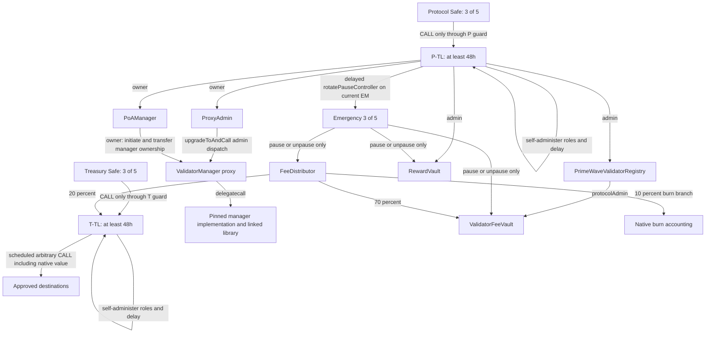

# PrimeWave custody and genesis: independent security review handoff

**Review candidate only. Not externally audited, production approved, or ready to deploy.**
Baseline: `06851936f51a723d666357c6fc45a168bb748054`, branch
`codex/mainnet-blocker-resolution`, strategy `DIRECT_MAINNET`.
This package grants no approval to create identities, access AWS, fund accounts,
sign, broadcast, start nodes or deploy. Contracts and production approval flags
are unchanged by the handoff. No live addresses or keys are supplied.

## Combined integration addendum

The original baseline inventory below is retained unchanged. See
[combined integration](COMBINED-GENESIS-INTEGRATION.md) for the collision-free
17-account synthetic graph, actual nonce/child-account export, independent Safe
1.4.1 rebuild and new tests. This resolves R06 for synthetic integration and the
selected Safe build-provenance gap; R01 final production VM/state proof remains
open. No original lock or approval was replaced.

## 1. Exact scope and provenance

`scope-evidence.json` is the machine-readable scope: SHA256 of every scoped local
Solidity source and relevant authoring/readiness/test inputs, exact artifact file
and runtime hashes, compiler settings per locally compiled artifact, full ABI
entry points including inherited functions, and synthetic account-state hashes.
File hashes cover bytes; runtime hashes cover decoded bytecode; account hashes
use sorted compact JSON. Compiler metadata keccak source hashes remain in the
local build artifacts. The inventory intentionally includes wider dependency
and test trees as context; inclusion does not claim every legacy deployment path
is suitable for production.

| Component | Exact review implementation / constraint |
|---|---|
| Protocol and treasury accounts | Published `@safe-global/safe-contracts` **1.4.1**, `Safe` and `SafeProxy`, separate five-owner / threshold-three accounts |
| Safe provenance | Vendored exact published artifacts and LGPL license; npm SHA512 and raw/runtime SHA256 in `config/mainnet/custody-artifacts.lock.json`; no Safe recompilation |
| Safe build limitation | Vendored Hardhat artifacts omit compiler metadata. Do **not** assign solc 0.8.30 settings to them. Independent reviewer must obtain/verify upstream reproducible build and full source/compiler provenance against these exact bytes; offline artifact identity alone is not that proof |
| Timelocks | `PrimeWaveCustodyTimelock`, inherited OpenZeppelin **5.6.1** TimelockController/AccessControl/receivers; fixed minimum 172800 seconds |
| Guards | `TimelockOnlySafeGuard`, one separately bound instance per Safe/timelock; custom, unaudited |
| Emergency | `PauseOnlyEmergencyMultisig` plus `EmergencyMultisig` base; custom, unaudited; legacy generic base is not the selected standalone controller |
| Fee/reward/registry boundary | `FeeDistributor`, `ValidatorFeeVault`, `RewardVault`, `PrimeWaveValidatorRegistry`; exact sources and ABIs included |
| Manager boundary | ICM commit **40e1c898d44242aee25693a9cde4bc2485bd8242**, ValidatorManager, PoAManager, ValidatorMessages; OZ/OZ-upgradeable **5.0.2**, not the custody OZ remapping |
| Proxy boundary | OZ5.0.2 TransparentUpgradeableProxy/ERC1967/ProxyAdmin; source hashes and upstream ABI references included. ABI references are not local compiled-runtime attestations |
| Authoring and gates | `CustodyGenesisState.s.sol`, shared `GenesisConstructorState.s.sol`, custody/genesis Python tools, `mainnet_readiness.py` |
| Local compiler | **0.8.30+commit.73712a01**, optimizer enabled / 200 runs, viaIR, Shanghai, metadata bytecodeHash=ipfs; full remappings and libraries recorded per artifact |
| Tooling observed | Foundry 1.8.1 used for baseline tests, despite historical 1.7.1 comments in foundry.toml; exact reproduction must record the actual tool version |

The manager build archive digests are pinned in `scripts/mainnet/build_manager.py`
and that file itself is hashed. Dependency Solidity trees are individually hashed
in the inventory; custody OZ5.6.1 additionally has an aggregate tree digest in the
existing lock. No lock is automatically updated on failure. Upstream audit links
in `../MAINNET-CUSTODY-READINESS.md` are background, **not** PrimeWave audit coverage.
The supported node/VM pair is AvalancheGo/Subnet-EVM1.15.1, protocol46; that is a
runtime prerequisite, not proof these final genesis artifacts have been accepted.

## 2. Authority graph and trust boundaries

Arrows denote capability, not immediate authorization. `P-TL` and `T-TL` are
separate non-upgradeable timelocks. Public signers and all production addresses
remain unresolved. Three disjoint five-address groups are required by the exporter;
distinct addresses do not prove independent people, devices, employers or custody.



Each paired Safe is initially its timelock's sole PROPOSER_ROLE,
CANCELLER_ROLE and EXECUTOR_ROLE. DEFAULT_ADMIN_ROLE is that timelock itself;
there is no deployer admin or zero-address open executor. No role is given to the
other Safe, emergency group or bootstrap gas payer. Safe slot0 points to the
shared locked singleton; each proxy has five owners, threshold3, nonce0, empty
module list, zero fallback handler, its own guard and no seeded approved hashes.
Guards have no owner/setters, transfer functions or upgrade path.

**Authority is broad after the delay.** Timelock self-calls can grant/revoke roles,
including an open executor or new admin, and can renounce roles. The guard is a
Safe call boundary, not a semantic allowlist of timelock payloads. A malicious
protocol quorum can schedule upgrades/takeovers; a malicious treasury quorum can
schedule withdrawal. The 48h floor alone does not prevent granting roles to EOAs,
removing cancellation ability, increasing delay indefinitely or burning custody. The Safe can also directly renounce its own timelock role through the permitted paired-TL call; the guard does not prevent self-inflicted role loss.
There is no cross-Safe veto and no independent emergency cancellation role.
Future role migration can deliberately change this graph; it must be reviewed.
Existing tests do not prove all future governance proposals preserve policy.

## 3. Entry points, inherited behavior and initialization

The complete compiler/published ABI inventory is in `scope-evidence.json` under
`artifactInventory.*.entryPoints`. That list includes public getters and all
inherited external functions; this table classifies the security surfaces. ABI
alone omits internal modifiers, inline proxy dispatch and library delegatecalls;
review their hashed source as well.

| Surface | Caller / privilege / effect |
|---|---|
| Safe `setup` | Public once, sets owners/threshold, optional initializer delegatecall/fallback/payment; the authoring path uses to=0, empty data, zero handler and payment. A publicly uninitialized proxy is forbidden |
| Safe `execTransaction` | Threshold-authorized signatures/approved-hash mode; paired guard requires CALL to paired TL and zero gasPrice/gasToken/refundReceiver. Nonce/hash/chain domain must be independently checked. Failed inner execution may produce outer success |
| Safe `approveHash` / signature surfaces | Inspect exact ABI: approveHash is owner-only; signMessage is **not** a Safe1.4.1 core entry point here. Contract signatures through `checkNSignatures` and approved-hash mode are upstream surfaces, not exercised by real keys |
| Safe owner functions | `addOwnerWithThreshold`, `removeOwner`, `swapOwner`, `changeThreshold` require self-call; guard prevents that route. No direct setter EOA bypass |
| Safe configuration | `setGuard`, `setFallbackHandler`, `enableModule`, `disableModule` require self-call, blocked by guard after initialization |
| Safe modules | `execTransactionFromModule` / `...ReturnData` can bypass the transaction guard if an enabled module exists. No modules are initialized; module absence is a required invariant, not a general Safe guarantee |
| Safe fallback/receive/proxy | Native receive allowed; fallback handler zero. SafeProxy delegates to singleton including receive/functions and special `masterCopy()` dispatch (not necessarily in ABI). Singleton remains constructor-locked, no upgrade setter. `simulateAndRevert`/`getStorageAt`, signature/hash/getter functions remain inherited surfaces; simulate delegatecall reverts state, but audit code/DoS effects |
| Timelock schedule/scheduleBatch | PROPOSER_ROLE, explicit operation hash/predecessor/salt and delay>=current minimum. Permission is not payload-policy approval |
| Timelock execute/executeBatch | EXECUTOR_ROLE or open-role if ever granted; ready/pending operation and predecessor required; arbitrary native-value CALL, no delegatecall opcode here. Untrusted targets may reenter; inherited pre/post state checks and atomic batch rollback need review |
| Timelock cancel | CANCELLER_ROLE for pending/ready operations; cancellation can be rescheduled, and scheduling salt/hash must be reviewed |
| Timelock updateDelay | Self-call only; custom override enforces >=172800. Increasing delay can lock future governance operationally |
| Timelock AccessControl | grantRole/revokeRole role-admin only, initially self; renounceRole by role holder. Inherited getRoleAdmin/hasRole/supportsInterface and operation views are public |
| Timelock native/token receivers | receive payable; inherited ERC721/ERC1155 holder callbacks accept tokens. Custody guard does not constrain timelock payload destinations or token transfers |
| Guard | Constructor sets nonzero safe/timelock. checkTransaction and checkAfterExecution require paired Safe; supportsInterface is public. No recovery/configuration setters |
| Emergency base | Anyone propose; signer approve once; anyone execute approved proposal; only original proposer cancel. Proposal ID binds target/data/nonce, not an off-chain signature. An untrusted proposer can cancel their own proposal even after approvals; use a trusted proposer operationally |
| Emergency execute override | Exactly4 calldata bytes, pause()/unpause(), one of three immutable-at-construction allowedTarget entries; zero value call. No withdrawal/upgrade/role selector permitted |
| Emergency rotatePauseController | Only P-TL; target allowlisted, replacement code nonempty. Code length does not prove safe interface or behavior. Replacement must be independently reviewed and can make future rotation impossible |
| ProxyAdmin | Ownable transferOwnership/renounceOwnership and owner-only upgradeAndCall; owner is P-TL. Delayed upgrade includes initializer delegatecall into new code. UPGRADE_INTERFACE_VERSION getter is informational |
| Transparent proxy | Non-admin fallback delegates to implementation. Immutable admin ProxyAdmin handles only upgradeToAndCall through internal dispatch; admin cannot fallback. ERC1967 slots alone are insufficient to prove immutable runtime admin |
| PoAManager | onlyOwner initiate registration/removal/weight changes and transferValidatorManagerOwnership; inherited transferOwnership/renounceOwnership. Public completion functions forward verified-message processing. Constructor binds immutable manager address and owner P-TL |
| ValidatorManager | initialize once with SubnetID/admin/churn, implementation constructor disables initialization; initialized owner PoA. Owner-only initiate **and complete** methods; PoA exposes permissionless complete wrappers, which call manager as its owner and still require verified messages. Public resend/migrateFromV1/initializeValidatorSet depend on pinned message/state checks. Include inherited transferOwnership/renounceOwnership. Verify exact modifiers in source |
| ValidatorMessages / Warp | Linked library and precompile trust boundary; manager's public conversion initialization is deliberately message-gated. Mocked success is no authentication proof |
| Registry / fee / rewards | Registry admin=P-TL, underlying manager pointer, fee vault admin=registry; public sync/update/claims must not add privilege. RewardVault admin=P-TL controls recipients, weights, emission (ratchet), stakingManager. FD destinations/split fixed. Exact ABI lists every entry point |
| Pause-controller setters | FD only current controller; VFV registry admin or current controller; RV admin or current controller. Current restricted emergency rotates only through P-TL. RV admin retains direct delayed setter. Pause stops selected distribution/claims, not all accrual/accounting or every admin operation |

RewardVault's one-time `setStakingManager` deserves explicit review: the selected
manager may call `distribute(to,amount)` subject to remaining reserve and pause,
bypassing the continuous emission rate. The initial PoA custody candidate leaves
that pointer unset; delayed admin authority to set it is powerful, not a harmless
configuration change. Registry admin functions registerValidator, setUptimeBips
and setRewardRecipient control fee-recipient/weight bindings; public sync paths
read the authoritative manager. VFV admin functions are reachable by the registry
contract, not by an arbitrary protocol signer. Review every target's exact modifier
and immutable pointer rather than treating all arrows as generic admin calls.

### Genesis initialization chain

1. Explicit PUBLIC addresses/signers/timestamp and custody mode are required;
   templates retain nulls/false approvals. No invented production address.
2. `author()` runs creation code at the selected final address in a cheatcode EVM,
   sets account nonce1, keeps returned runtime and recorded constructor storage.
   Safe singleton and proxies, Safe.setup, both timelocks, guards and emergency
   are authored there. Guard installation uses vm.prank(Safe), **not** a real
   signature or valid on-chain bootstrap transaction.
3. Shared core authoring copies code/state for non-self-administered core contracts,
   sets controller state and RewardVault accounting with synthetic funding.
   Treasury has15M; RewardVault has15M totalFunded and balance. No later duplicate
   funding is permitted. All extra custody accounts have zero genesis balance.
4. Export includes12 accounts, code/nonce/balance/storage. Pure Python validation
   binds hashes, checks Safe slots/guard bindings and exact C00 supply100M. It is
   not a proof of arbitrary storage semantics or full VM compatibility.
5. Manager implementation/library/proxy/ProxyAdmin/PoA are a **separate unfinished
   production state bundle**. Proxy runtime immutables, generated ProxyAdmin address,
   linked libraries, initialized slot, final SubnetID and all ownership must be
   authored/verified together. Public proxy initialization may never be deferred.
   Do not blindly copy constructor storage to a different proxy address.
6. CreateSubnet readiness must not depend on the future SubnetID. CreateChain
   readiness must require the accepted SubnetID, exact approved final genesis,
   manager initialization, custody state/role VM proof and a separate transaction
   approval. Conversion and subsequent operations retain their own approvals;
   nothing in this package substitutes for those gates.

## 4. Threat model and unresolved review register

Assets: native treasury/genesis allocations, fee/reward funds, validator set,
upgrade authority, signing authority and chain availability. Adversaries include
outsiders, compromised signers/operators/build environment, malicious quorum,
untrusted recipients and malicious/upgraded dependencies. Trusted assumptions
include correct EVM/Warp/P-Chain, verified build artifacts and intended human
custody independence. Severity below is **provisional review priority**, not an
external auditor finding or a claim of an exploit confirmed in current code.

| ID / priority | Threat, current boundary and unresolved acceptance evidence |
|---|---|
| R01 Critical | Final genesis storage/code/immutable mismatch or uninitialized manager permits takeover or lock. Require exact accepted subnet-bound genesis, all getters/slots/runtime/library checks in actual target VM. Current fake-manager fixture is insufficient |
| R02 Critical | Timelock bypass/unauthorized value via Safe modules, delegatecall, refunds, fallback, seeded approvals or wrong guard. Require independent code/bytecode review, all alternate signature paths and invariants; synthetic tests cover selected negatives, not exhaustive proof |
| R03 High | Three compromised signers control delayed arbitrary calls and can replace role policy. No guardian veto. Require owner risk acceptance, monitoring/cancellation runbook and independent custody; emergency cannot cancel timelock operations |
| R04 High | Loss of three signers, broken guard, renounced admin/executor or bad rotation can permanently lock funds/control. No backdoor is present. Require explicit no-recovery acceptance and rehearsed safe migration |
| R05 High | Emergency escalation through selector/target ambiguity, unsafe replacement controller or mutable target semantics. Require review of wrapper/base and all three targets; tests reject representative arbitrary calls. Emergency pause/unpause can still deny service |
| R06 High | Synthetic build namespaces must not be combined: cached manager artifact links ValidatorMessages at `0x000000000000000000000000000000000000b010`, while custody fixture uses that address for Safe singleton. They are separate test contexts, **not** one usable genesis. Require disjoint owner-reviewed production addresses, relink/rebuild and final combined runtime proof. No production addresses have been selected |
| R07 High | Actual signatures, domain/nonce/chain replay, hardware wallet UX, contract signers and relayer behavior untested. Require real ceremony/tooling validation under separate authorization; never use synthetic approved-hash tests as signing evidence |
| R08 High | P-Chain conversion/Warp authentication, validator availability and live consensus are not proven. Mocks use fabricated node/BLS/message values. Require separately authorized full final-state compatibility and network evidence. Two equal validators are a non-resilient pilot |
| R09 Medium | Bootstrap payer circularity, Safe refund prohibition, nonce/gas exhaustion or griefing can stall governance. Require a narrowly budgeted external PW gas payer and operational monitoring; no mint/new allocation |
| R10 Medium | Outsider emergency proposer can cancel own proposal or spam nonces; trusted proposals and monitoring required. Anyone execute does not grant extra selectors; quorum still controls approvals |
| R11 Medium | Compiler/tool/dependency compromise or metadata drift. Require reproducible Safe provenance, local compiler binary provenance, dependency archive checks and clean independent rebuild; hashes of compromised inputs are not security proof |
| R12 Medium | Inner Safe call may fail while outer receipt succeeds; timelock batches/recipient reverts/reentrancy may block progress. Require inner events/return/state, cancellation/reschedule procedure and adverse-recipient testing |

No critical exploit was confirmed in this documentation handoff. No finding is
closed by this statement. Reviewer may raise/lower severities and add findings.

## 5. Recovery procedures and hard limits

These are proposals, **not transaction authorization**. Freeze new proposals,
identify exact chain/addresses/hash/nonce/operation state and preserve evidence
before any action. Never weaken a guard or reset genesis/database as recovery.

| Incident | Feasible route / authorization / no-recovery boundary |
|---|---|
| One or two Safe signers lost | Remaining quorum can propose a replacement fully initialized/guarded Safe, independently verify all owners/roles, schedule atomic grants of proposer/executor/canceller to new Safe and revocations from old Safe on the same TL, wait>=48h, execute using old executor, check new Safe can schedule/execute and old cannot. Keep self-admin and balances unchanged. New identities require separate authorization |
| Fewer than three available | Check already-scheduled operations and any **existing** separately authorized executor before concluding. With initial roles only on the inaccessible Safe and no executable rescue operation, no unilateral recovery; other Safe, emergency, operator and deployer cannot rescue. Lost keys are not repairable by source update |
| Guard blocks all Safe calls | No guard admin/removal route; Safe.setGuard self-call is blocked. A previously scheduled valid role migration still needs an authorized executor able to call TL. If none can execute, permanent lock. Do not suggest Safe module enablement as a bypass |
| Malicious/bad proposed migration | While old quorum and guard work, old Safe cancels pending operation. Inspect hashes and state; fix reviewed new Safe before rescheduling. Cancel is subject to ordering/front-running once operation is ready |
| Migration execution reverts | OZ batch reverts atomically, so grants/revokes roll back together; inspect inner Safe failure and timelock pending state before retry. Do not assume outer receipt success means migration succeeded |
| Migration executes wrong roles | If old or new authorized quorum still has a usable schedule/execute route, a new delayed correction may be possible. If last usable proposer/executor/admin lost, no recovery. Off-chain owner consent alone cannot restore on-chain roles |
| Emergency quorum lost | P-TL can schedule rotation through current restricted controller, replacing each of its three targets after review. Must still have protocol quorum and current controller/code ability. A bad replacement that cannot rotate FD can permanently strand that control; RV direct admin setter does not fix FD/VFV globally |
| Protocol quorum lost but treasury works | Treasury has no protocol rescue role. It controls its own funds only. Reverse also holds; protocol quorum cannot rescue the treasury under initial graph |

Pre-migration acceptance: inspect new singleton/runtime/guard bindings, all five
owners and threshold, empty modules/handler, nonce/domain, no EOA role grants,
complete role diff including admin, exact atomic batch, predecessor/salt and
balance invariants. Obtain independent review of calldata and separate owner
transaction approval. Monitor role grant/revoke, ownership/implementation changes,
new operations, cancellation/execution, guard/module/handler changes and quorum
availability. Alerts and a48h delay do not guarantee an honest quorum will cancel.

## 6. Offline reproduction and evidence

Run at the baseline with dependencies, compiler, Foundry and the three pinned
public source archives already available. No package installation/download,
network, RPC/fork environment, broadcast, key or wallet arguments. A new checkout
must acquire/review dependencies separately; fail on missing assets, never use
stubs or regenerate the lock to make a mismatch pass.

```sh
unset ETH_RPC_URL FOUNDRY_ETH_RPC_URL FOUNDRY_FORK_URL
forge --version
forge build --offline
python3 scripts/mainnet/verify_custody_artifacts.py
forge test --offline --match-contract CustodySecurityTest -vv
python3 tests/integration/build_custody_fixture.py
python3 -m unittest discover -s tests -p 'test_custody_genesis.py'
python3 -m unittest discover -s tests -p 'test_direct_mainnet.py'
# Existing digest-verified archives AND extracted sources required:
python3 scripts/mainnet/test_custody_manager.py --archives /path/to/public-archives --forge /path/to/forge
python3 docs/security-review/reproduce_evidence.py
# Broader optional regression run (not a node):
forge test --offline
python3 -m unittest discover -s tests -p 'test_*.py'
```

All Forge tests above use an in-process synthetic EVM, not a running node.
`build_custody_fixture.py` rewrites only the labeled synthetic fixture; require no
baseline diff afterward. The evidence comparison script is read-only by default,
fails on missing/different output and invokes no subprocess/network. `--write`
creates new files exclusively; it never updates locks, flags or production inputs.
Manager inventory includes a locally linked synthetic artifact with an explicit
B010 library mapping; generic unlinked rebuilds or different link addresses will
fail comparison. Use the per-artifact compiler settings and hash-verified public
archives to reproduce the exact review build, not an assumed production link map.
The proxy ABI-reference artifacts do not close the missing final proxy runtime
proof. The archived candidate can be reproduced directly from the committed fixture by
this comparison script, without running Forge or approving addresses.

- `tests/fixtures/custody-genesis.fixture.json`: actual12-account authoring export,
  synthetic owner inputs and fake manager `0x6000`. Test-only address-review fields
  are true **inside the synthetic fixture**, not owner consent. Outer production
  approval false; production templates remain null/false.
- `synthetic-genesis.candidate.json`: deterministic materialized candidate from that
  fixture, exact100M PW; deployable=false / genesisApproved=false. It is evidence,
  never an input to a real CreateChainTx.
- `scope-evidence.json`: source/artifact/ABI/state hashes and candidate digest.
- `validation.json` and `offline-tests.txt`: this handoff's limited rerun, and
  separately labeled baseline test results/limitations. No results fabricated as
  an independent audit.

Tests do **not** prove: final genesis acceptance by Subnet-EVM; actual combined
manager/library/proxy/PoA/custody state and immutable correctness; genuine
signatures/key custody/EIP-1271 owners; real P-Chain owner auth/AVAX fees/conversion
proof; authenticated Warp precompile behavior; real validator BLS identities;
consensus/liveness/replacement acknowledgments; actual fee-credit AddBalance,
full fee/gas accounting under load, storage persistence/recovery, production
monitoring or RPC security. Round-trip tests clear and restore the recorded slots
in the authoring EVM; they do not prove that no unrecorded constructor slot was
omitted, account nonce semantics in a fresh chain, or behavior in an entirely
new target-VM state database. Fake nonzero addresses are not custody evidence.
No node is started by this handoff. Earlier Linux
binary execution history is not final-genesis compatibility evidence.

## 7. Auditor deliverables and acceptance criteria

Auditor supplies independent commit/build hash, tools/commands, exact examined
inputs, issue IDs with reproductions and impact, severity/rationale, remediation
and retest status, and an explicit coverage/limitations statement. Never mark this
package audited merely because it was delivered.

| Severity | Classification / release treatment |
|---|---|
| Critical | Unauthorized funds/control, initializer takeover, bypass of compulsory delay, or irrecoverable loss under expected honest use; block release until fixed and independently retested |
| High | Material governance/custody compromise or realistic permanent denial/lock; block release until fixed or explicit documented owner/security-review risk decision where legitimately an intentional design risk |
| Medium | Bounded DoS, operational/accounting/recovery weakness; mitigation and owner disposition required |
| Low / informational | Hardening, clarity, provenance gaps without demonstrated material impact; document disposition and scope |

Auditor checklist (all **OPEN**, no acceptance granted):

- [ ] Rebuild pinned custody artifacts and establish independent Safe1.4.1 source/build provenance; verify dependencies, ABI inventory and compiler/remappings.
- [ ] Review Safe transaction/signature/module/fallback/refund/simulation paths, chain domain and zero seeded approvals; enumerate internal delegatecalls.
- [ ] Prove initial TL closed roles/self-admin, >=48h floor, no deployer bypass; review all AccessControl grants/renounces and batch/reentrancy behavior.
- [ ] Trace every native/token movement and forced-credit path; prove exact C00 balances and no mint/zeroing/duplicate RewardVault funding.
- [ ] Verify emergency selectors/targets/current-controller rotation and malicious targets/controllers; distinguish emergency pause from governance takeover powers.
- [ ] Inspect actual manager/proxy/admin/library immutables, protected initialization, conversion/Warp checks, public migration/resend paths and churn bounds.
- [ ] Review/rehearse successful and failed Safe migration, lost quorum/guard lock, proposed role loss and inability to recover; require explicit residual-risk decision.
- [ ] Validate final SubnetID-bound combined genesis against target VM with owner-approved public inputs under a separately authorized test plan; no public uninitialized proxy.
- [ ] Confirm CreateSubnet/CreateChain separation and independent exact-artifact transaction approvals; no synthetic evidence accepted as production proof.
- [ ] Review gas-payer record, accounting/monitoring/receipt rules and owner custody ceremony; no direct EOA governance role.
- [ ] Resolve R01–R12 with finding-specific evidence, owner decisions and independent retest; no unresolved Critical/High exploit declared ready.

## 8. Required next owner decisions

Select reviewer/scope and approve review engagement separately; accept or reject
the proposed Safe/custom-guard/timelock/emergency architecture after findings.
Provide public owner/address metadata and evidence of independent custody only
through a separately authorized ceremony; approve final ChainID, predeploy address
map and final genesis inputs separately. Decide no-backdoor/lost-quorum risk,
role-migration policy, two-validator pilot risk and the gas-payer record below.
Transaction approvals, spending authority and any node testing/deployment remain
separate future decisions. Nothing here authorizes execution.
